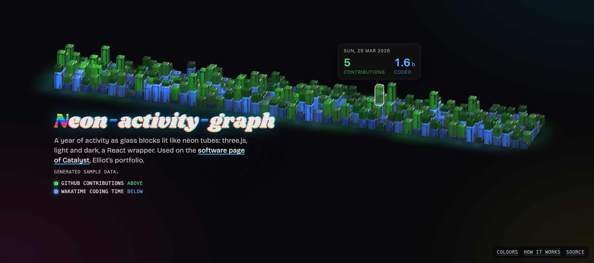
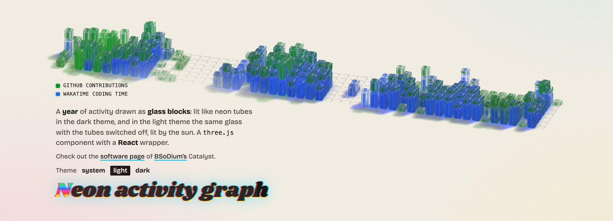
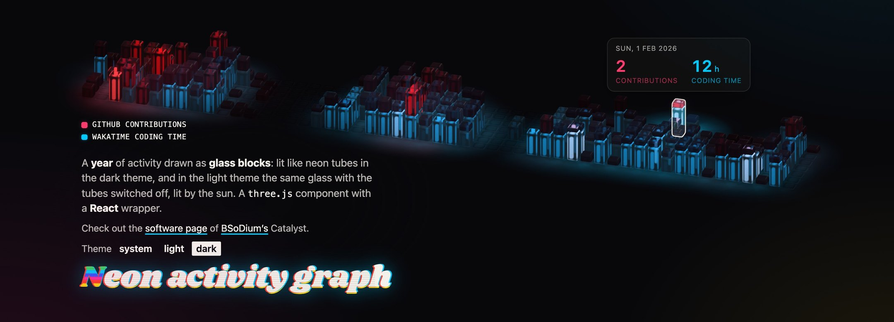
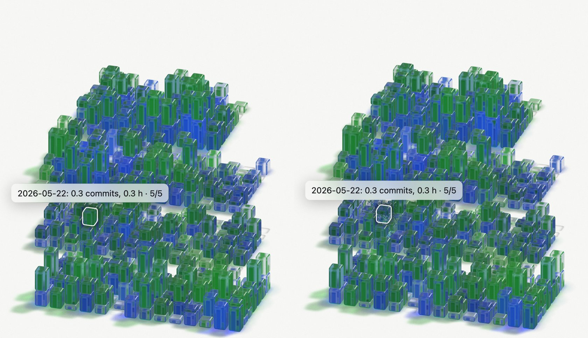
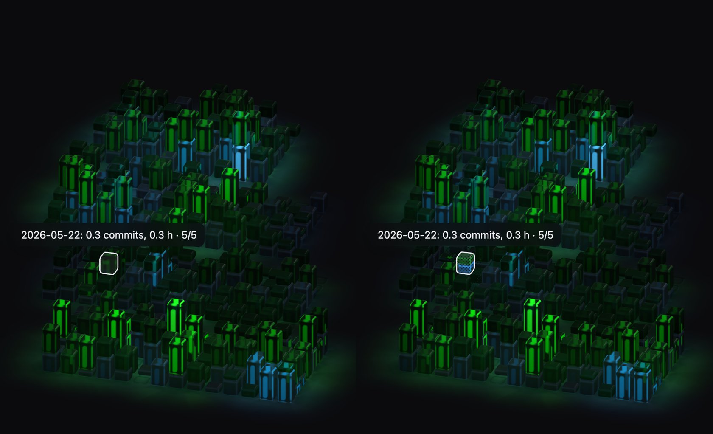

# neon-activity-graph

[](https://www.npmjs.com/package/neon-activity-graph) [](https://github.com/BSoDium/Neon-activity-graph/actions/workflows/ci.yml) [](LICENSE)

A year of activity drawn as glass blocks, in three.js. Each day is a column of two blocks (say GitHub contributions on top of coding time).

- **Dark theme:** every block holds a neon tube. When the graph appears, the tubes stutter on like a gas sign, with a synthesised hum and bell-like clicks, and now and then a few of them flicker.
- **Light theme:** the same glass with the tubes switched off, lit by the sun. The glass casts coloured shadows and caustics, traced on the GPU. No sound.

**[Live demo →](https://neon.bsodium.fr/)** (the author's own GitHub and WakaTime activity, refreshed every 6 hours)

<p>
  
</p>
<p>
  
  
</p>

The camera never moves, so the picture is rendered progressively (soft shadows and anti-aliasing accumulate over a few dozen frames), and then the GPU goes idle.

It draws the graph and nothing else: no panel, no figures, no legend. Hover and keyboard selection are handed to you as data (`onHover`), so the card around it is yours; an optional [overlay](#overlay) draws a ready-made one.

## Features

- Framework-agnostic core (`createActivityGraph`) and a React component (`neon-activity-graph/react`).
- Generic data: two layers of `{ date, value }`, with adapters for GitHub's contribution calendar and WakaTime's summaries.
- Light and dark themes (following `prefers-color-scheme` by default), custom colours that can change live, and a "string of lights" mode with a colour per tube.
- A layout for narrow boxes (four staggered strips), a `lite` mode for phones and weak machines, and `prefers-reduced-motion` support.
- A flat placeholder drawn at once (and server-rendered by the React component), seen by the scene's own camera, so the scene replaces it in place.
- No assets to host: the dark theme's baked light is embedded (a 41 KB PNG, decoded only in the dark theme).
- `three` is a peer dependency, imported on demand: nothing of three.js loads until a graph is created.

## Install

```sh
npm install neon-activity-graph three
```

`react` (18 or later) is an optional peer dependency, needed only for `neon-activity-graph/react`. The graph needs WebGL 2.

## Quick start

### Vanilla

```ts
import { createActivityGraph, fromGitHubCalendar } from "neon-activity-graph";

const graph = createActivityGraph(document.getElementById("graph")!, {
  data: {
    top: fromGitHubCalendar(calendar), // GitHub's contributionCalendar, or any GraphLayer
    bottom: { label: "Coding", unit: "h", days: [{ date: "2026-11-19", value: 3.5 } /* ... */] },
  },
  onHover: (day) => {
    // day: { index, date, top, bottom, outline, x, y, behind? } or null
  },
});

graph.update(newData);  // draws other data (rebuilds the graph)
graph.setTheme("dark"); // "light" | "dark" | "auto"
graph.destroy();        // frees the GPU resources and the listeners
```

Give the container a size: the picture fills it. One strip wants an aspect of about 4:1; `strips: 4`, about 4:5.

### React

```tsx
import { ActivityGraphView } from "neon-activity-graph/react";

<ActivityGraphView data={data} theme="auto" overlay className="aspect-[4/1] w-full" onHover={setDay} />;
```

The component takes the same options as `createActivityGraph`, plus `className`, `style` and `aspect` (the box's width / height: 3.97 for one strip and 0.8 for several by default, so the server-rendered placeholder has the right shape).

Memoise `data`: a new object rebuilds the graph, as do `strips`, `weeks`, `lite`, `templatesUrl` and turning `rodColor` on or off. A new `theme` or `colors` is applied in place, and callbacks can be new closures on every render.

## Data

```ts
interface GraphData {
  top: GraphLayer;
  bottom: GraphLayer;
}

interface GraphLayer {
  label?: string; // used by the hover card and the accessible label, not drawn
  unit?: string;  // "contributions", "h"
  days: { date: string /* "2026-11-19", read in UTC */; value: number }[];
}
```

- The graph shows the last `weeks` weeks (53 by default), ending at the latest day of either layer. Missing days are 0 (a flat tile); either layer can be empty.
- A block's height and colour follow `sqrt(value / max)` within its layer.
- Adapters (pure, no network):
  - `fromGitHubCalendar(calendar)`: GitHub GraphQL's `contributionsCollection.contributionCalendar`.
  - `fromWakaTimeSummaries(summaries)`: WakaTime's `/users/current/summaries`, in hours.
  - `fromRecords(rows, date, value, label?, unit?)`: anything with a date and a number; rows on the same day add up.
  - `fakeLayer({ seed, days, end, scale })`: repeatable fake data for demos and tests.

## Options

| Option | Default | |
| --- | --- | --- |
| `data` | required | The two layers, or `null` while they load: only the placeholder shows until `update(data)`. |
| `weeks` | `53` | How many weeks are drawn. |
| `strips` | `1` | `1` is one long strip; `4` staggers four strips for a narrow, tall box (aspect about 0.8). |
| `theme` | `"auto"` | `"light"`, `"dark"` or `"auto"` (follows `prefers-color-scheme`). Change it with `setTheme`. |
| `colors` | green on top, blue below | `{ top?: { light?: [low, high], dark?: [low, high] }, bottom?: ... }`: the glass of a quiet day and of the busiest one, as `#rrggbb` or `0xrrggbb`. See [Theming](#theming). |
| `background` | the nearest opaque ancestor's | A CSS colour, or `(theme) => css`. The ground takes it, so the picture has no seam with the page. Call `setTheme` again after it changes. |
| `rodColor` | | `({ layer, index, date, t }) => [r, g, b] \| null`: each tube's colour in the dark theme. See [Theming](#theming). |
| `sound` | `true` | The start-up's hum and clicks, and the hum of the selected tube. See [Sound](#sound). |
| `reducedMotion` | `"auto"` | `"auto"` follows `prefers-reduced-motion`; when reduced there is no start-up and no flicker. |
| `lite` | `"auto"` | A third of the frames, a lower resolution, simpler blocks. `"auto"` turns it on for coarse pointers, 4 CPU cores or fewer, or under 4 GB of memory. |
| `grain` | `0.012` | Film grain strength; `0` turns it off. |
| `placeholder` | `true` | The flat days, shown at once and pulsing, faded out when the first picture is on screen. |
| `overlay` | off | `true` or `{ outline?, card?, locale? }`: the selected day's outline and a day card, drawn over the graph. See [Overlay](#overlay). |
| `label` | "Activity graph, one column a day. …" | The accessible name. |
| `templatesUrl` | embedded | Where to fetch `caustic-templates.png` from, instead of the embedded data URI. |
| `cutaway` | `true` | `false`, or `{ strength?, dot?, noise?, variation? }`. While a day is selected, the days that stand in its way (that hide it from the camera) are screened away, whole, in both themes, so a day behind taller ones can be seen. `strength` is the share taken away (`0`–`1`, default `0.6`: a grainy screen is left; `1` is gone), `dot` the halftone cell in CSS px (default `1`, about a pixel: a photographic grain; `0` for a fine noise), `noise` how grainy the screen is (`0` a regular halftone, `1` pure grain; default `0.9`), `variation` how much the opacity of the dots varies (`0` all alike, `1` from nearly clear to opaque; default `0.6`). See [Cutaway](#cutaway). |
| `maxPixelRatio` | `2` | The highest pixel ratio rendered (`lite` always renders at 1). |
| `maxPixels` | `8_000_000` | The most pixels rendered; a larger container is rendered at a lower ratio. |
| `debug` | | `{ metrics?, wireframe?, neonHold? }`: development helpers (`data-*` timings on the container, the glass as a cage, the picture held half on). |

### Callbacks

| Callback | |
| --- | --- |
| `onHover(info \| null)` | The day under the pointer or the arrow keys: `{ index, date, top, bottom, source, theme, outline, x, y, behind? }`. `source` is what selected the day: `"pointer"`, `"touch"` or `"key"` (to word a hint, "click" or "tap", or to draw your own focus state). `outline` is the SVG `points` of the column's silhouette and `x, y` a point on its top, in CSS pixels of the container. Clicking where days stand behind one another cycles through them (`behind: { index, count }`). |
| `onLayout(bounds)` | Where the blocks are, `{ left, right, top, bottom }` in CSS pixels of the container, on the first layout and on every resize. |
| `onReady()` | The first picture is on screen. |
| `onRedrawn()` | The picture has been drawn again and is in focus: after the first build and after every rebuild (theme, colours, resize). Time an effect to this rather than to the click that asked for it. |
| `onLit(lit)` | `false` while the start-up runs, `true` once the picture is lit. |
| `startup({ inView })` | Called each time a start-up is prepared; return `{ start?, stop? }` to hook your own sound or greeting to it. |

### The graph object

| Member | |
| --- | --- |
| `update(data)` | Draws other data (the graph is rebuilt). |
| `setTheme(theme)` | Switches the theme; the start-up plays again in the dark theme. |
| `setColors({ top?, bottom? })` | Changes the colours in place. See [Theming](#theming). |
| `cling("small" \| "big")` | One of the start-up's bell-like clicks, on demand (for a change the visitor made). Silent in the light theme and when `sound` is off. |
| `bounds` | The blocks' bounds (`null` before the first layout). |
| `ready` | A promise that resolves when the graph has been built (or has failed). |
| `destroy()` | Stops everything and frees the GPU resources and the listeners. |

### Lining things up with the picture

The isometric view leaves empty ground in the corners of the box, so a caption lined up with the box looks off. The blocks' bounds are set on the container as the CSS variables `--nag-content-left`, `--nag-content-right`, `--nag-content-top` and `--nag-content-bottom` (and in `graph.bounds` and `onLayout`). They are predicted from the geometry at creation, so a caption placed with `left: var(--nag-content-left)` is right from the first paint; the scene's own measurement replaces them a moment later (a few pixels at most).

### Without three.js

`neon-activity-graph/layout` needs neither three.js nor a browser: the adapters, the grid of days, `predictBounds(weeks, strips, width, height)`, and `placeholderTiles()` / `placeholderMarkup()` for a flat placeholder (an SVG `viewBox` and one path of all the squares) seen by the scene's camera.

## Theming

- **Themes.** `"auto"` follows `prefers-color-scheme` and its changes. The ground takes the page's background (`background`, or the nearest opaque ancestor's), so the picture sits on the page without a seam.
- **Colours.** Each layer has two tones per theme: the glass of its quietest day and of its busiest one; the days in between are mixed. The defaults are a GitHub-like green on top and a blue below, with tubes tuned to them; other colours get a generic tube (the hue lifted toward white).
- **Live changes.** `graph.setColors({ top, bottom })` (or a new `colors` prop in React) rebuilds the blocks in place, without the start-up and without new data. The first change is applied at once; changes in the next 120 ms (dragging a colour input) are folded into one more rebuild. The old picture stays, softened, until the new one is in focus: about 0.3 s on a laptop.
- **Coloured tubes.** `rodColor` gives a tube a colour of your own in the dark theme (linear RGB around 0..1, and above 1 for a brighter light; `t` is how busy the day was); returning `null` keeps the stock green or blue neon for that tube, so a few red tubes among the default ones is a one-line function. A coloured tube has clear glass in its colour. When most tubes are coloured (a whole string of lights) the picture also takes a clear-glass look with no grey veil and a softer bloom. The light theme ignores it.

The [demo](https://neon.bsodium.fr/) has a few presets (Technicolor, Ice, Sunset, Mono) and colour pickers.

## Overlay

`overlay: true` (or `<ActivityGraphView overlay />`) draws the selected day's outline (an SVG path around its blocks) and a day card over the graph. `outline: false` and `card: false` turn either off, `outlineColor` is `"auto"` (default, see below), `"cased"` or `"text"` (the text colour), `card` can also be a function `(info) => string | Node` for your own content, and `locale` formats the default card's date. Style it with CSS variables on the container or above: `--nag-outline`, `--nag-outline-halo`, `--nag-outline-fill`, `--nag-card-bg`, `--nag-card-fg`, `--nag-card-muted`, `--nag-card-radius`, `--nag-top`, `--nag-bottom`.

**The outline's colour.** In the dark theme the outline is the text colour. In the light one the blocks can be dark and saturated, and a dark line is lost on them, so the outline is a white line with a soft, subtle dark halo round its outside only (a blurred near-black stroke, masked out inside the outline): it reads on dark glass (white on dark) and on the pale ground (the halo) alike. `outlineColor: "cased"` does the same in both themes, `"text"` is the text colour alone. `--nag-outline` (the line) and `--nag-outline-halo` (the halo colour; `transparent` for none; `--nag-halo-width`, `--nag-halo-blur` and `--nag-halo-opacity` tune it) override either.

`createHoverOverlay(container, options, labels)` is the same overlay on its own, for a graph you drive yourself.

## Cutaway

<p align="center">
  
  
</p>

Days stand behind one another from the camera, so the selected one is often hidden. With `cutaway` (on by default) the days that are in its way are screened away whole: not just made transparent, but turned into a halftone (a 45-degree grid of holes that grow with the fade), so they read as seen through rather than vanished. "In the way" is exact: a few points of the selected day (the centre, top and bottom of its blocks, and their corners drawn in a little) are looked at toward the camera, and every other day with a block that one of those lines goes through is faded. The days beside it, behind it, or too low to hide it stay. Each day eases in and out by itself (about 90 ms), so when the selection moves, the days that were in the way come back while the new ones go, with no pop. The ground, shadows and caustics are left as they are. The fade is done per fragment in the blocks' own shaders (the halftone's edges are smoothed by the camera's sub-pixel jitter over the accumulated samples), and only while the selection is changing: nothing is redrawn at rest. In the dark theme it goes with the existing glow (the selected day brighter, the rest dimmer): the glow says *which* day, the cutaway lets it be seen. With reduced motion it switches without easing. `cutaway: false` turns it off; the pure `inTheWay` and `resolveCutaway` are exported.

## Sound

All sound is synthesised with Web Audio; there are no files.

- The dark theme's start-up: a low ballast hum that dies away, and soft bell-like clicks as areas of tubes catch.
- The idle flickers, and a faint hum on the selected tube that follows its brightness.
- `graph.cling()`, on demand.

Sound plays only once the browser lets the page make it (after the visitor has interacted with the page), and only while the graph is on screen and the tab visible. The light theme is silent: its tubes are off. `sound: false` turns it all off.

## Accessibility

- The container is a `group` with an accessible name (`label`).
- The graph is in the tab order: Tab lands on it and selects the latest day, then the arrow keys walk the days (left and right by week, up and down by day), Home and End go to the first and last day, PageUp and PageDown four weeks back and forward, and Escape (or Tab away) lets go. The focus ring is the browser's `:focus-visible` one on the container: restyle it with CSS, or draw your own from `onHover` (`source: "key"`).
- The overlay announces the selected day through a polite live region (for the keyboard and for taps, not for a mouse sweeping over the days).
- With `prefers-reduced-motion` (or `reducedMotion: true`) there is no start-up and no flicker.

If the graph carries information your page does not give elsewhere, add a text alternative of your own (a summary or a table).

## Performance

- Nothing moves, so the picture is drawn once, a frame at a time (96 jittered samples; 32 in `lite`), and then the render loop stops. Hovering only re-lights the blocks: a few frames, then it stops again.
- The start-up and the idle flickers change the blocks' light, not their geometry: a light update costs about 0.05 ms of CPU and a frame about 0.5 ms on an Apple M4 (0.7-0.8 ms and 4-5 ms on an emulated Pixel 7 with the CPU slowed 6x).
- The one-time build (geometry, ground light) blocks the main thread for a few hundred ms, up to 1.3 s on a slowed phone.
- Flickers run only while the graph is in view and the tab visible.
- The picture is rendered at the container's size times the pixel ratio (up to 2); above 8 million pixels the ratio drops. Measured in Chrome on an Apple M4: a 2352 px wide graph at ratio 2 renders 4704 x 1184 px (5.6 MP) and is on screen after about 1 s, with a one-time build hitch of 250-330 ms, then rAF at 16.7 ms (p95 16.8 ms) and a JS heap of about 100 MB. GPU memory was not measured: expect a few hundred MB of half-float render targets at that size, which `maxPixels` bounds.

## Browser support

Anything with WebGL 2 and half-float render targets: current Chrome, Edge and Firefox, Safari 15+, iOS Safari. Without WebGL 2 the graph fails (and logs it); check first if you want a fallback:

```ts
const supported = !!document.createElement("canvas").getContext("webgl2");
```

## How it works

- **Light theme.** The sun's light through the glass is traced on the GPU (`ground-light.ts`: a vertex shader that splats rays onto the ground) with refraction, Fresnel, total internal reflection, the glass's colour absorption and rounded edges. The ground's brightness is a signed difference to what it would get with no glass, so the shadows are coloured and soft and the caustics are the surplus. `glass-caustics.ts` is the readable CPU version of the same optics, and what the tests check.
- **Dark theme.** There is no sun: the light is each block's tube. What one block casts on the ground is baked: `assets/caustic-templates.png` holds path-traced templates (Mitsuba 3) of a glass block with a tube inside, for 3 block heights x 4 heights above the ground, averaged over the square's symmetries. The graph lays the right template under every block, in the tube's colour. Tracing this live does not work: with the rays a page can afford, the result is noise.
- **Start-up.** The blocks are cut into 5 adjacent rectangles of different sizes, each with its own 2-4 stutters and a short warm-up. A block whose tube is still off is dim, lit only by its neighbours. Afterwards, rarely and less and less often, a small batch of tubes flickers like a real sign's.
- **Grain.** A soft, luminance-dependent noise in the last pass, like a camera's.

More on the dark theme's glass and tubes: [`docs/dark-glass-and-rods.md`](docs/dark-glass-and-rods.md).

### Regenerating the caustic templates

Only needed if the blocks' shape or the tube changes. See [`scripts/caustic-templates/README.md`](scripts/caustic-templates/README.md) (Mitsuba 3, about 15 minutes), then `pnpm embed:templates` rewrites the embedded data URI (`pnpm build` does it too).

## Development

```sh
pnpm install
pnpm dev        # the playground: fake data and every option
pnpm demo       # the demo page
pnpm test       # vitest
pnpm typecheck
pnpm build      # dist/ (embeds the templates, then tsup)
```

The [demo](https://neon.bsodium.fr/) (`demo/`) draws the author's current activity: GitHub contributions over WakaTime coding time. `demo/scripts/fetch-activity.mjs` fetches public data without a token, and a scheduled workflow writes `activity.json` to the `data` branch every 6 hours (set the repository variables `GITHUB_LOGIN` and `WAKATIME_USER` to draw someone else's). Without that file the demo falls back to generated data. Its fonts are Shrikhand, Bricolage Grotesque and JetBrains Mono, all under the SIL Open Font License 1.1 (licence texts in `demo/public/fonts`), self-hosted Latin subsets.

## Releasing (maintainers)

Releases go through npm Trusted Publishing (OIDC): no npm token is created or stored. The trusted publisher is set on npmjs.com (package > Settings > Trusted Publisher > GitHub Actions: user `BSoDium`, repository `Neon-activity-graph`, workflow `release.yml`, environment empty). `0.1.0` was published by hand, since a trusted publisher can only be attached to a package that already exists.

To release:

1. Bump `version` in `package.json` and commit.
2. Tag and push: `git tag vX.Y.Z && git push origin vX.Y.Z`.

The `release` workflow type-checks, tests, builds and publishes with provenance. The tag must match `package.json`; a tag for a version already on npm does nothing.

## License

[MIT](LICENSE) © Elliot Négrel-Jerzy
